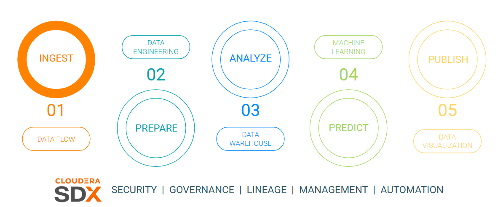

# Lab 1 - Cloudera Data Flow

In this lab you will take a tour of Cloudera Data Flow by configuring and deploying a NiFi flow from the Catalog to ingest data from a Kafka topic into the Open Lakehouse.

**Goals**

- [ ] Consume data from a Kafka topic
- [ ] Convert the data to Parquet format
- [ ] Store the data in a table in the Lakehouse

## Requirements

Ensure the following requirements are met in order to run this exercise:

- [ ] Hands on Lab user id

## Tasks

### 1. 

### 2.

### 3.