# Lab 1 - Cloudera Data Flow

In this lab you will take a tour of Cloudera Data Flow by configuring and deploying a NiFi flow from the Catalog to ingest data from a Kafka topic into the Open Lakehouse.

**Goals**

- [ ] Consume data from a Kafka topic
- [ ] Convert the data to Parquet format
- [ ] Store the data in a table in the Lakehouse

## Requirements

Ensure the following requirements are met in order to run this exercise:

- [ ] Hands on Lab user id

## Tasks

### Open Cloudera Data Flow

From the Cloudera on cloud Tenant home page, click on DataFlow.

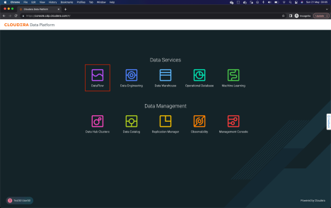

Once in DataFlow, click on the option **Catalog** from the left menu. The data ingestion application templates are listed here. For the purpose of this workshop, we have created and published a template that allows you to read Kafka topic data and ingest/store it in the Lakehouse provided by CDP Public Cloud.

Click on the Flow called `{{ kafka_to_lakehouse_flow_name | default("cdp_hol_kafka_to_lakehouse") }}` to start deploying it.

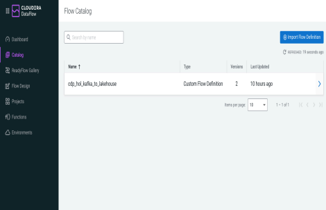

### Configure and Deploy Flow

When clicked, the panel shown in the image below appears with the Flow information. It shows the available versions, creation date, creator user, and a button **Deploy** to start the deployment. Click on that **Deploy** button.

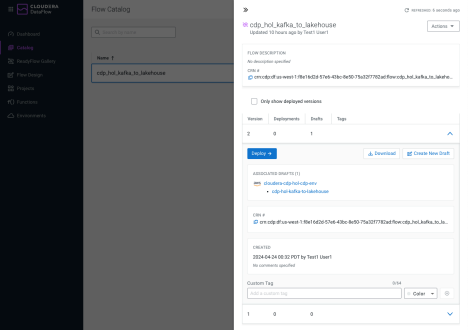

The popup window that appears allows you to select the DataFlow cluster in which you want to deploy the Flow. In this case, the cluster to be selected is **`{{ cdp_environment_name | default("cloudera-cdp-hol-cdp-env") }}`**. Once selected, click **Continue**.

!!! info
    The workshop instructor will tell you which environment to select.

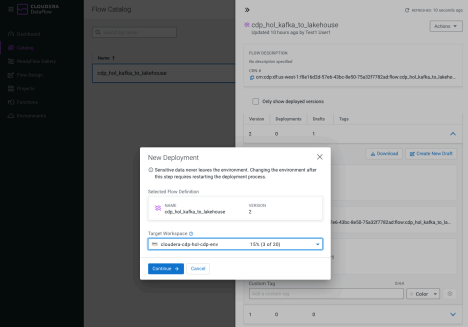

From this point, you will need to enter the Flow configuration. 

Start by assigning a **Deployment Name**, **Target Project**, and click **Next**.

- For the purposes of this workshop, please name the Flow starting with your assigned username. For example, `user000`
- Select `workshop` or `Unassigned` for the **Target Project**. This is a way to organize your flows.

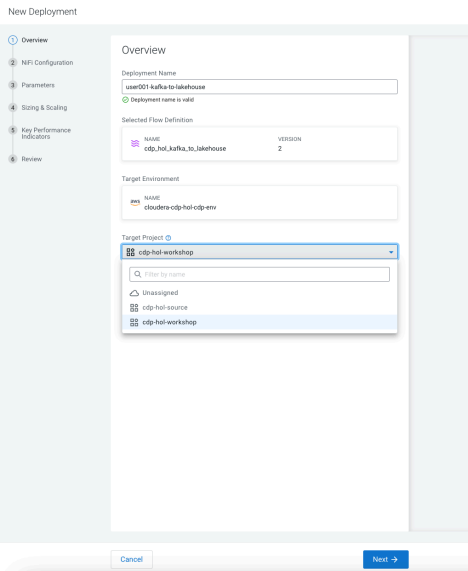

Make sure the option **Automatically start flow upon successful deployment** is checked
and click **Next**.

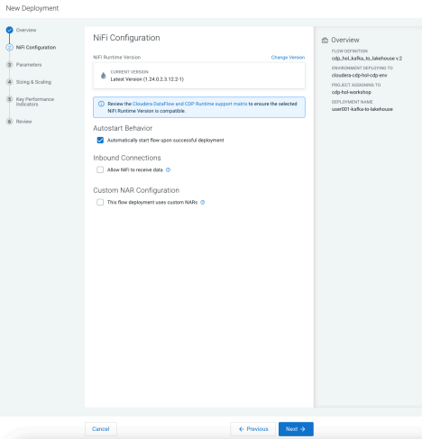

In this part of Parameters, you must enter the following values:

- **CDP Workload User Password**: Enter the Workload Password shared at the beginning of the workshop.
- **CDP Workload Username**: Enter the assigned User ID (example. `user001`)
- **Database**: Enter User ID
- **Kafka Brokers**: `{{ kafka_brokers }}`
- **Kafka Consumer Group Id**: Enter `<user id>-group` (eg. `user050-group`)
- **Kafka Topic**: `{{ kafka_topic }}`

For the purposes of this workshop, the remaining values were filled out for you and don’t need to change.

Review that the parameters were entered correctly. Then click **Next**.

!!! NOTE
    For the purposes of the workshop, your user (e.g. `user050`) is also the name of the database where you will store the data (which has already been created for you), and the name of the Kafka Consumer Group ID for reading messages.

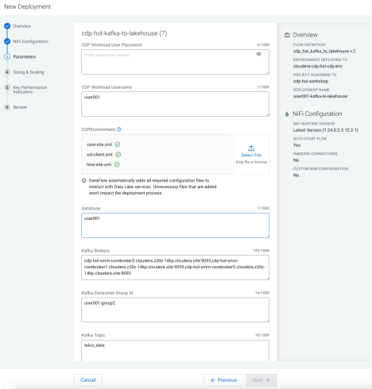

There is no need to configure auto-scaling parameters. Click **Next**.

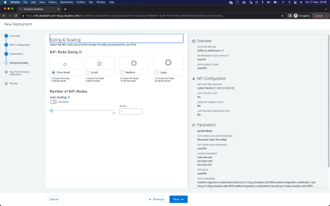

We are also not going to configure KPIs now. Click **Next** to continue the configuration.

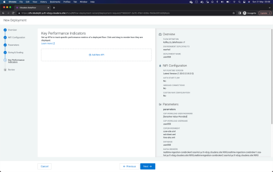

Review all the information entered for your Flow, then click on **Deploy** to start the deployment process.

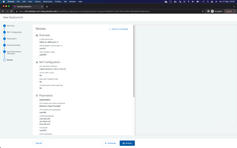

### Track and Manage Deployment

The blue box indicates that the Flow deployment process has been started. By clicking on the **Load More** button you will be able to see the different stages of the deployment. After approximately 60 to 90 seconds, the last event should be _Deployment Successful_.

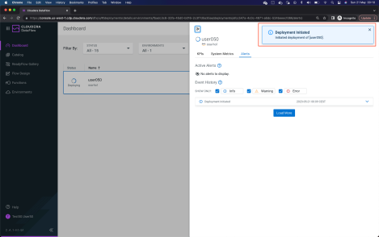

Once the deployment is finished, click on **Manage Deployment** to see the details of the recently deployed Flow.

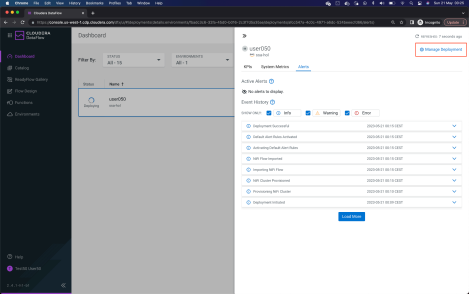

### View the deployed NiFi Canvas

In the Deployment Manager window you will see the Flow information displayed.

It is time to execute the application processes from the graphical Flow Management interface. Click on **Actions** -> **View in NiFi**, to open Cloudera Flow Management canvas in a new window/tab.

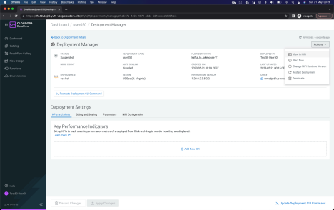

Double-click on the Process Group to open it.

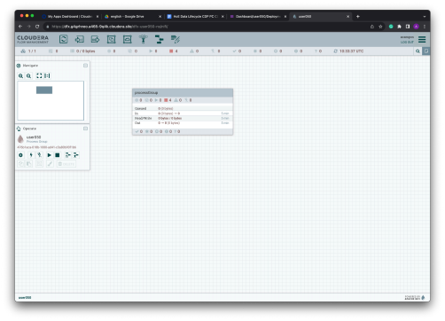

When opening the Process Group, you should be able to see the Processors that compose the Flow application. To summarize, there are four Processors:

- _ConsumeKakfaRecord_, consumes data from the Kafka topic, reading the data in JSON and outputting in AVRO.
- _MergeRecords_, to group the flow files and streamline the data flow.
- _ConvertAvroToParquet_, conversion needed to store the data in PARQUET format.
- _PutIceberg_, to insert the data into the table in the Lakehouse. The destination table is called telco_kafka_iceberg, and each user has an assigned database (`<user_id>` is the name of the database).

As you can see, the Processors are not started, they are paused.

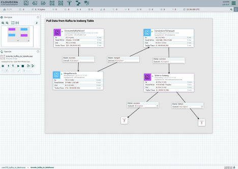

From the _Out_ field in every processor, you can see that data has flowed through in the past 5 minutes. You have already consumed data from Kafka and to Iceberg!

### Inspect and Modify the Flow

Flow Management allows us to see and access data in motion during the execution of the data flow.

Between Processors **ConsumeKafkaRecord** and **MergeRecords**, there is a connection. This connection is what joins the Processors and transmits data from one to the
other, and you can check how much data is queued at every step of the process.

Let's see this in action by building up the queue. In this case, existing kafka data already consumed and we want to explore other features of the NiFi processor. We are configuring
ConsumeKafkaProcessor to pull the data with different kafka consumer groups.

First, right-click on **MergeRecords** processor and click **Stop**. Repeat the same for processor **ConsumeKafkaRecord**

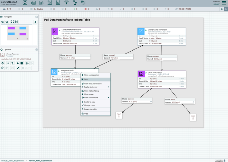

Right click on **ConsumerKafkaRecord** processor and click on **Configure**

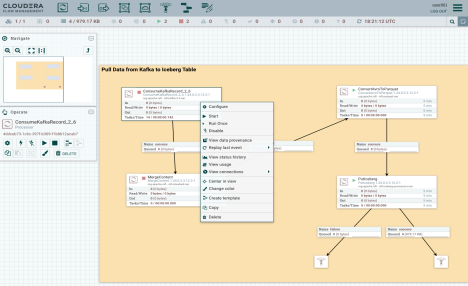

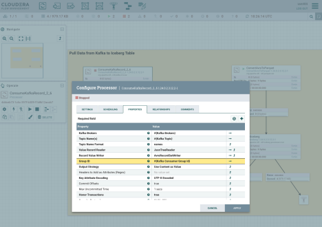

Change the consumer group id by clicking on **Group ID** value and chaning the consumer group id (eg. `#{Kafka Consumer Group Id}-v1`). Click **OK** and **Apply**

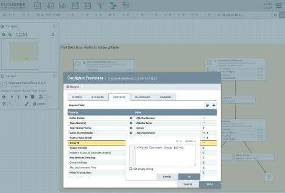

Start the ConsumerKafkaRecord processor by right clicking and **Start**.

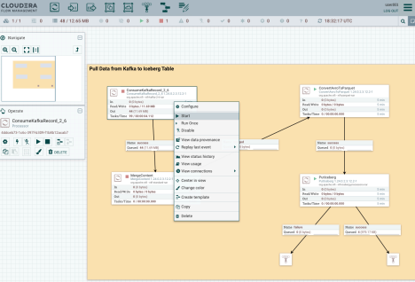

You will see data start to queue up in the connector shortly after starting.

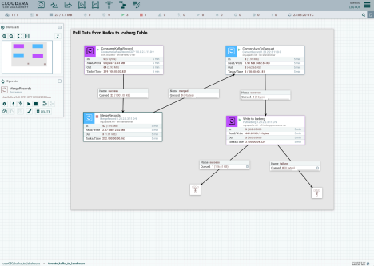

!!! tip
    You can refresh the counter by pressing the Ctrl+R (Windows) or Command+R (Mac) combination on the keyboard.

At some point there should be a number next to the legend _Queued_ in the connection between **ConsumeKafkaRecord** and **MergeRecords**.

To see the queued data, right-click on the
connection and click on the option **List Queue**, opening a popup window.

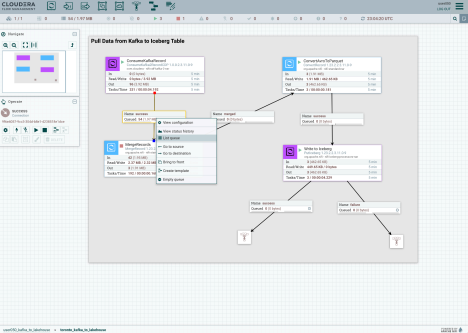

The next popup window lists the queued data. Click on the information icon (:material-information:) that appears
on the left side to view the events.

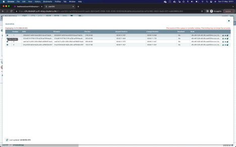

Once the FlowFile detail window appears, click on the button **VIEW** to open the content of consumed events.

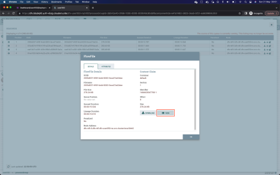

The new window that opens shows the data of the FlowFile content. Being in AVRO format, it is not fully readable. A deserializer must be selected to correctly display the data. For this, in the upper left, select the option `formatted` from the **View as** menu.

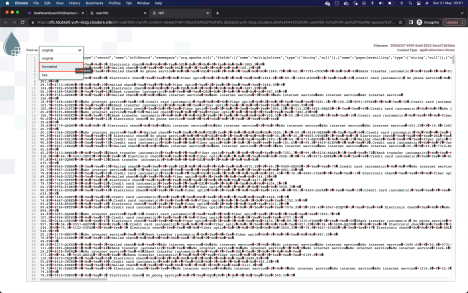

Now you can display the data correctly. Notice that the fields or attributes indicated at the beginning of the workshop appear. You can close that FlowFile window and the popups, returning to the canvas with the four Processors.

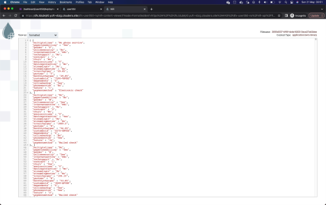

Start the stopped **MergeRecords** processor again to resume the flow. Remember that you can refresh the flow counters with the combination `Control+R` or `Command+R`.

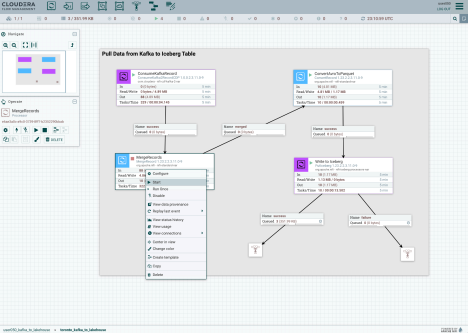

If the previous steps were executed correctly, the connection of the Processor **PutIceberg** to a funnel should be of type success.

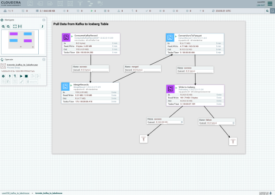

### Bonus - Data Provenance

NiFi is a powerful ingestion tool that gives you granular visibility into everything that's done to the data.

For example, right-click on any processor and then click on **View data provenance** to see this in action.

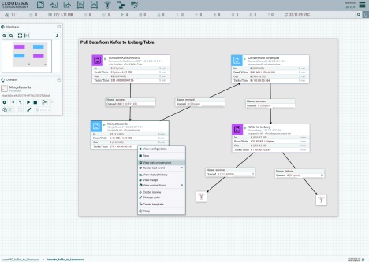

**End of Lab 1**