# Lab 3 - Cloudera Data Warehouse

In this lab you will take a tour of Cloudera Data Warehouse by querying data from the Open Data Lakehouse and building a dashboard to visualize the results.

**Goals**

- [ ] Configure Cloudera Data Warehouse
- [ ] Query data in Iceberg
- [ ] Created a visualization within Cloudera Data Vizualization

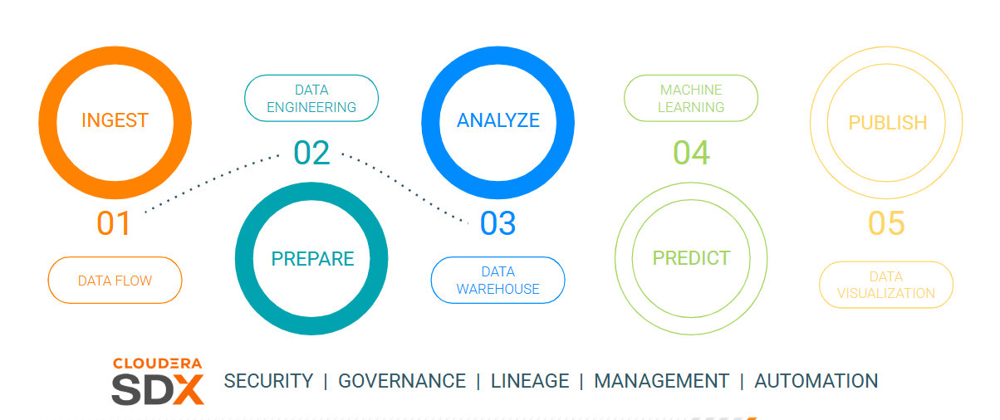

## Requirements

Ensure the following requirements are met in order to run this exercise:

- [ ] Hands on Lab user id

## Tasks

### Open Cloudera Data Warehouse

From the Cloudera on cloud Tenant home page, click on Data Warehouse.

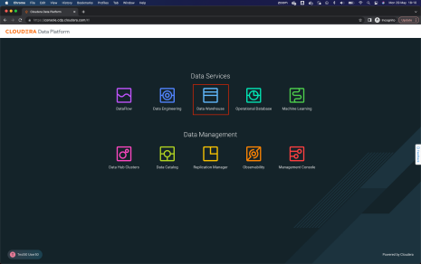

The Data Warehouse Home shows the deployed database catalogs, and virtual warehouses and allows access to data vizualization clusters.

Click on **Data Vizualization** from the left menu.

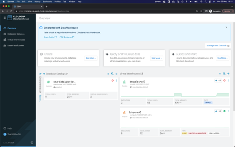

In Data Visualization, click on the **Data Viz** button for the cluster instance your user was assigned.

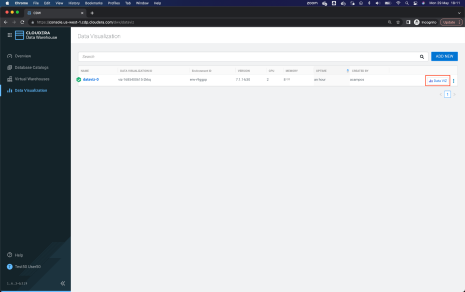

### Create a Dataset in Data Vizualization

Once in Data Visualization, go to the Data option from the top menu, and then to the Connector _ImpalaConn_ from the left menu.

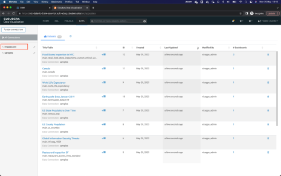

We have to create a new data source, for that, click on **New Dataset**. A window will
appear to enter the information of the new data source.

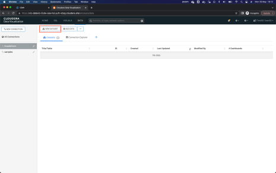

Enter the information for the new data source as follows:
- **Dataset title**: `<User Id>.telco_curated_data`
- **Dataset Source**: From table
- **Select Database**: `<User Id>`
- **Select Table**: telco_data_curated

Click on **CREATE** to create the new Dataset.

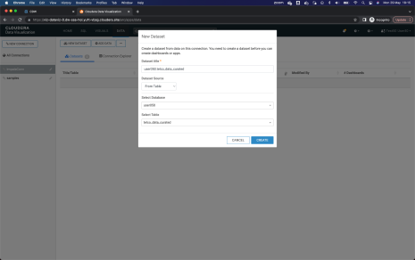

### Explore Dataset in Data Vizualization

The new Dataset should appear in the list. Click on the dataset that you just created.

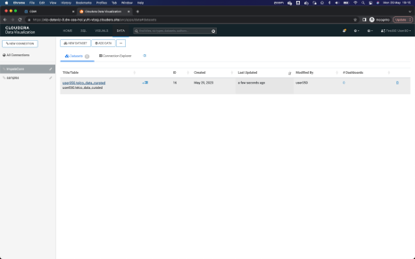

Here you will see the details of the dataset.

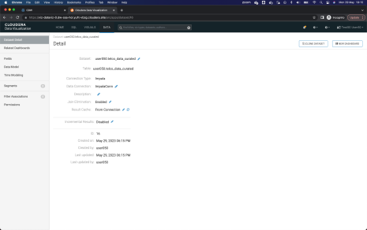

Click on **Fields** (left menu) to see the fields automatically captured during the dataset creation
process.

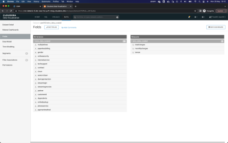

You can also preview the data from this screen. Click on **Data Model** (left menu) and then
on the button **Show Data** that appears in the center.

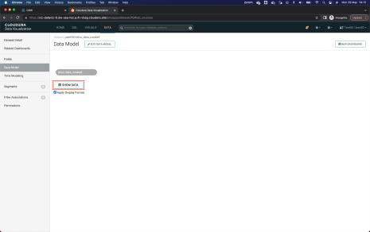

At this moment, a query to the Virtual Warehouse is executed to retrieve the data from the
data set. Notice the columns and values.

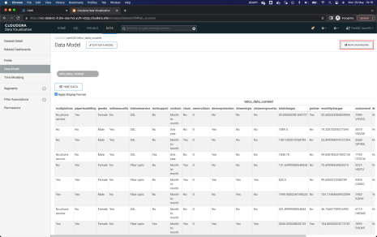

### Create Data Vizualization Dashboard

Click **New Dashboard** to create a new dashboard.

When opening the design canvas of a new panel, remove the element that is added by
default, by clicking on the three dots (`...`) button at the top right of the element, and then clicking on the option **Delete Visual**

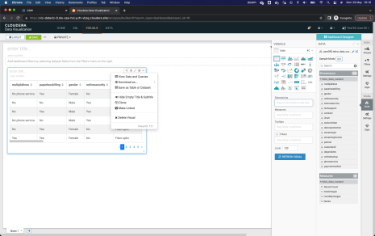

At the top of the canvas, in the enter title field, enter the name `Churn Analysis` to identify the dashboard.

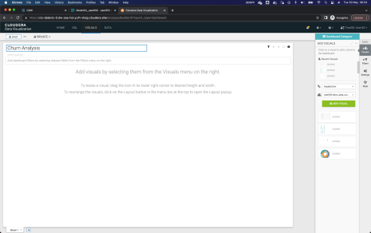

To add a new visual element, click on the button **Visuals** from the right menu, select the
dataset that corresponds to them, and click on the button **New Visual**.

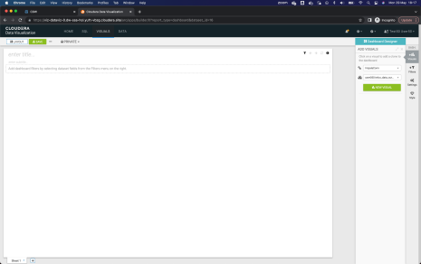

Add the first visual element, which is a Pie Chart with the dimensions **churn** and **contract**,
with the metric of **Record count**. Once finished, click the button **Refresh Visual**.

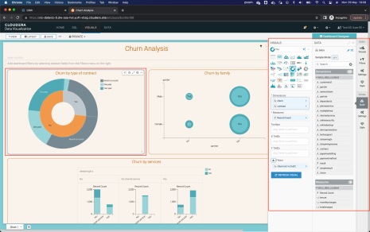

Add the second visual element, which is a Scatter Chart with the dimension **partner** like X
Axis, **gender** how Y Axis, **dependents** as Colors and **avg (total charges)** as Size. Once
finished, click the button **Refresh Visual**.

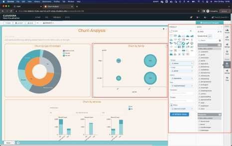

Add the third visual element, which is a Bar Chart with the dimensions **streamingtv** and
**streamingmovies** like X Axis,
**Record Count** how Y Axis and **churn** how Colors. Once finished, click the button **Refresh Visual**.

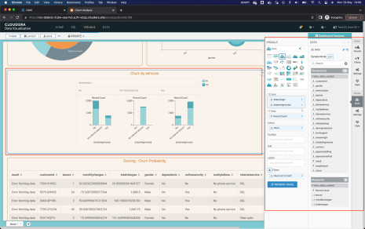

Add the fourth and last visual element, which is a table with the dimensions and metrics of
the dataset. Be sure to add all 17 dimensions and 3 metrics to the table. Once finished, click the
button **Refresh Visual**.

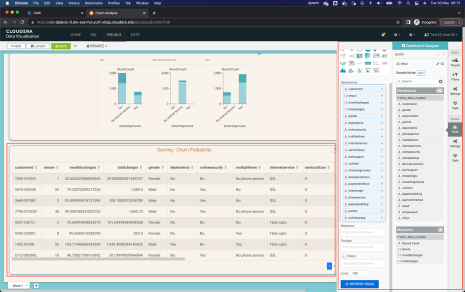

Save the dashboard by clicking the button **Save** from the top menu.

**End of Lab 3**