# Lab 4 - Cloudera AI

In this lab you will get hands-on with Cloudera AI by training a machine learning model. You will then deploy the model as a REST API for real time predication.

**Goals**

- [ ] Train a Machine Learning model to predict customer churn
- [ ] Deploy the trained model for real time scoring/prediction

## Requirements

Ensure the following requirements are met in order to run this exercise:

- [ ] Hands on Lab user id

## Tasks

### Open Cloudera Machine Learning

From the Cloudera on cloud Tenant home page, click on Machine Learning.

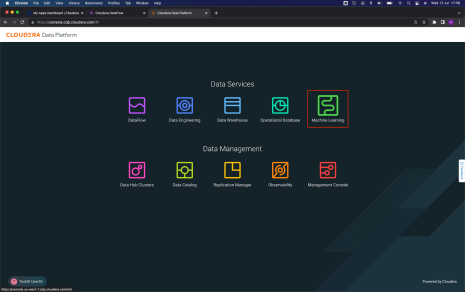

The Cloudera AI Home shows all available Workbenches, which is a compute resource allocation for Data Science related jobs.

Click on the {{ cai_workbench_name | default("only")}} Workbench that appears.

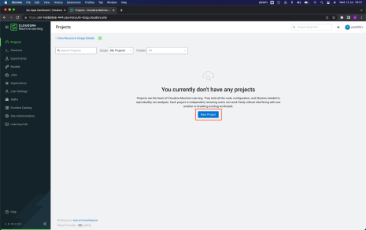

### Create Cloudera AI project

Once in the Workspace, you should see the following interface. Here are the projects you have created. It is time to create a new project. Click on the blue button **New Project**.

Enter the following information to create a new project:

- **Project Name**: Telco Churn
- **Project Visibility**: Private
- **Initial Setup**: Select Git
- In the text field below **HTTPS**, enter the url of the git repo: [https://github.com/campossalex/TelcoChurn](https://github.com/campossalex/TelcoChurn)

Keep the rest of the settings the same. Click the button **Create Project**

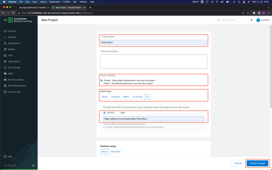

Once the project is created, you should see the screen shown below.
On this screen are the following sections.

- **Models**, deploy and manage models as REST APIs to serve predictions.
- **Jobs**, automate and orchestrate the execution of batch analytics workloads
- **Files**, assets that are part of the project, such as files, scripts and code

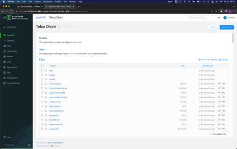

This Telco Churn project consists of running three scripts. The way of execution is through a session, which is the allocation of isolated compute resource for each user.

For this, you must click on the blue button **New Session**, located in the upper right. Make sure to **enable Spark**, marking the corresponding check, and click on the button **Start Session**.

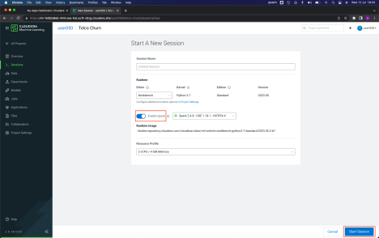

When you start a session for the first time, it will ask if you want to use a data connection. This project does not need this type of connection. Mark the check of **Don’t show me this again**, and then click the **Close** button, so this window will not appear anymore.

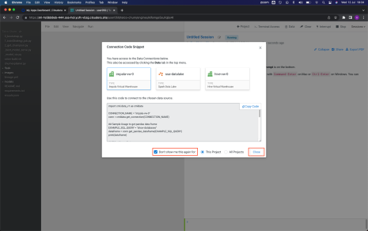

The editor/notebook located on the right side of the window will be in Scheduling status, and the bottom command bar flashing red. This means that CML is allocating computation for your session.

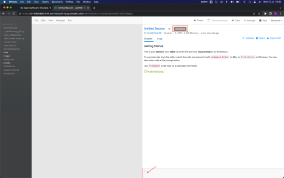

After a few seconds, the status changes to Running, and the command bar to green. This means that the session is ready to run code.

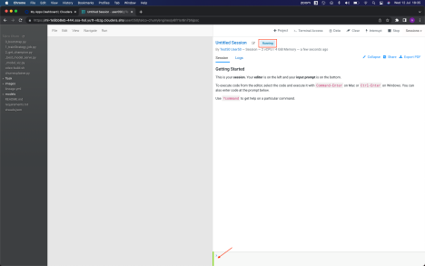

### Run the Bootstap Script

The first script/code to run is `0_bootstrap.py`. This Python code configures the libraries required for the project and integration with Lakehouse tables you populated before.

Select (just one click) the file in the bar located on the left side of the interface, this will make the code appear in the editor. Once the file is selected, click on the :material-play-box: button to run the code.

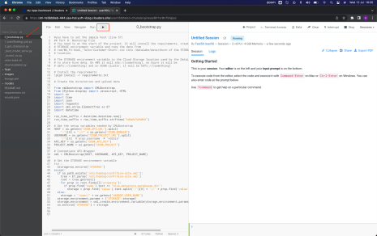

When you start execution, you will see code output on the right side of the interface, and the bottom command bar flashing red, indicating that it is busy.

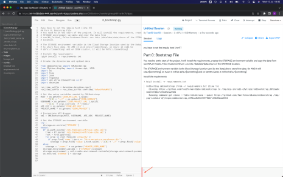

The green command bar indicates that the execution of the code has been finished. This
bootstrap code takes 3-4 minutes to run.

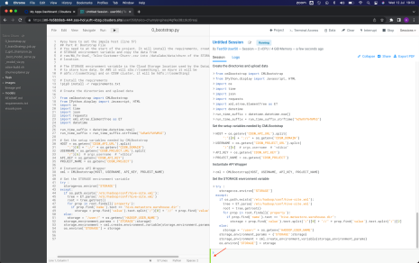

### Run the Train Strategy Script

The second script/code to run is `1_trainStrategy_job.py`. This Python code will create the Experiment to run the model with three different hyper parameters and records the precision.

Select (just one click) the file in the bar located on the left side of the interface, this will make the code appear in the editor. Once the file is selected, click on the :material-play-box: button to run the code.

Once the execution is finished (approximately 1 minute), click on the **Project**, located in the upper right bar of the session to go back to the project home.

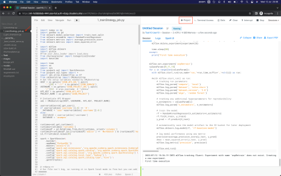

From the Project menu, click on the **Experiments** option, from the left menu, and then on **expRetrain** in the list of Experiments that appears.

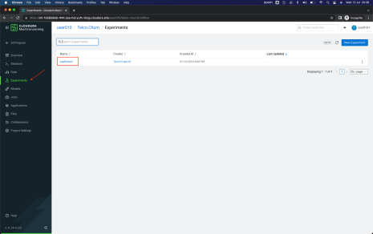

On this screen you will see the three runs of this experiment. Look at the last column, where precision attribute displays. This is the precision that each hyper parameter is delivering.

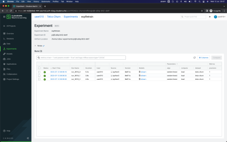

### Run Get Champion Script

Let's go back to the session to run the last code. Since sessions run in Kubernetes containers, it's very easy to get back to where we were.

Click on the option **Sessions** from the left menu, and later in the only session that will appear in the list. If you didn't name your session when you started it, it should be called _Untitled Session_.

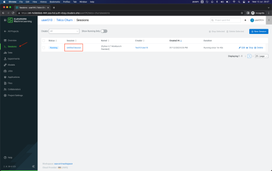

The third and last script/code to run is `2_get_champion.py`. This Python code takes the hyper parameter of the execution of the Experiment with the better precision and deploys two
Models as REST API, one to be integrated in Data Visualization and another for unit use for calls.

Select (just one click) the file in the bar located on the left side of the interface, this will make the code appear in the editor. Once the file is selected, click on the :material-play-box: button to run the code.

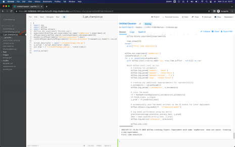

After a few seconds, you will see the following message "Deploying Model..." repeated several times, and the bottom command bar will be red.

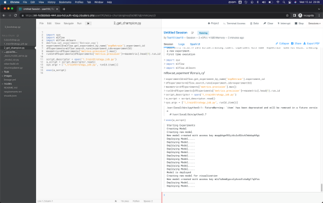

After about 2 minutes, the last message should be "Model is deployed", and the bar will be green. This means that the Deployment of the two Models is complete. Click on the **Project** button, located in the upper right bar of the session to return to the home page of the project.

### Test Deployed Models

Once on the home page of the project, you will see the two Models displayed. Click on the one that starts with **ModelOpsChurn**.

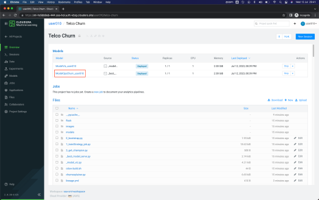

Here you will see Model information and settings in the Overview tab.

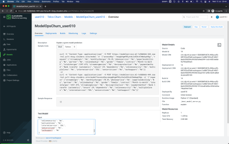

To test it and make a request to the model, scroll down, and click on the button **Test**, which will take the value in JSON format that is in the field **Input** and will make the request call to the model.

What you see in the **Result** field is the response from the model in JSON format.

If you wish, you can change some of the parameters of the **Input** field (for example, change some values from `No` to `Yes`), and call the model again, and observe the value of the attribute probability of the response to see if there were any changes.

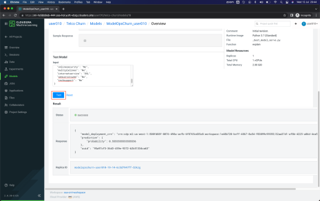

**End of Lab 4**