# Lab 1 - Cloudera Data Vizualization

In this lab you will dive deeper into Cloudera Data Vizualization by using the output of the machine learning model to enrich your DataViz application.

**Goals**

- [ ] Enrich Data Viz application with real time model scoring
- [ ] Add a new field that makes calls to the Cloudera AI Machine Learning model

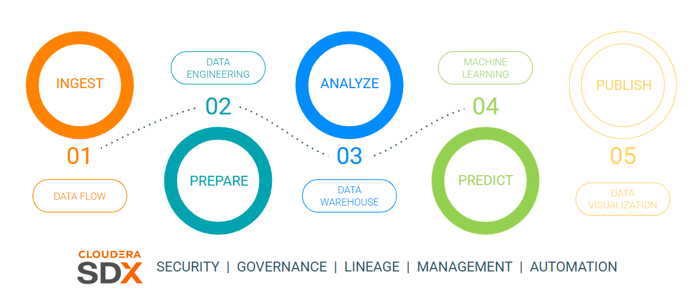

## Requirements

Ensure the following requirements are met in order to run this exercise:

- [ ] Hands on Lab user id
- [ ] Cloudera AI models deployed as part of[Lab 4 - Cloudera AI](../lab4-cai/README.md)

## Tasks

### Open Cloudera Data Vizualization in Data Warehouse

From the Cloudera on cloud Tenant home page, click on Data Warehouse.


The Data Warehouse Home shows the deployed database catalogs, and virtual warehouses and allows access to data vizualization clusters.

Click on **Data Vizualization** from the left menu.


In Data Visualization, click on the **Data Viz** button for the cluster instance your user was assigned.


### Add Field to Data Vizualization Dataset

Edit the previously created Dataset, in **Data** -> **<User Id>.telco_data_curated**.


Once in the Dataset, go to **Fields** in the left menu and then click on **Edit Field** to edit the
fields of your dataset.

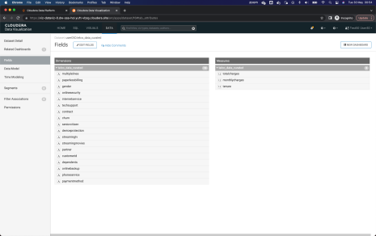

In the list of **Dimensions**, click the down arrow of the last field in the list, and select the option **Clone**.

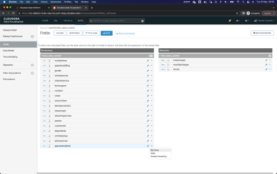

Once the field is cloned, click on the pencil next to the field to edit it.

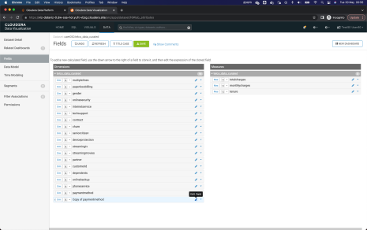

In the popup window that appears, enter the name of the new field in **Display Name**. We suggest that you enter `ChurnScore`.

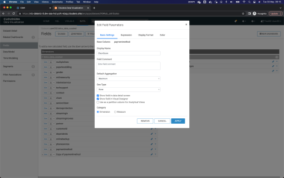

Go to the Expressions tab and enter the following value in the Expression field. This will allow you to call the REST API of the Model you have previously deployed.

```
cviz_rest('{"url":"<url_del_workspace>","accessKey":"<access_key>","colnames":["monthlycharg
es","totalcharges","tenure","gender","dependents","onlinesecurity","multiplelines","internetservic
e","seniorcitizen","techsupport", "contract","streamingmovies", "deviceprotection",
"paymentmethod","streamingtv","phoneservice", "paperlessbilling","partner",
"onlinebackup"],"response_colname":"result"}')
```


### Retrieve Field Details from Cloudera AI model

Open Cloudera AI in table of the web browser.

Go to the section of Models of your project, and click on the Model that begins with the name _ModelViz_, followed by your assigned username.

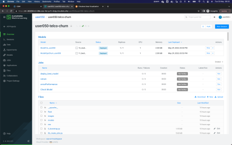

In the Overview tab, copy the URL that allows you to interact and call the workspace API.

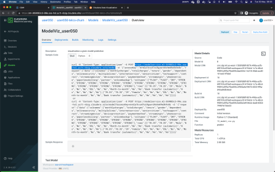

Replace the copied Workspace API value in the attribute `<url_del_workspace>` of the Expression field in Data Vizualization.


Returning to Cloudera AI, copy the accessKey of the model.

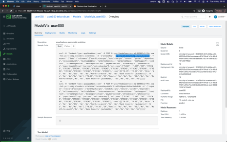

Replace the copied value in the attribute `<access_key>` of the Expression field.

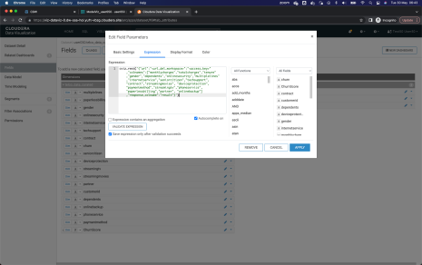

Finish the process of copying the _url del workspace_ and the _accessKey_, click the **Validate Expression** button at the top of the window. If the message appears in green _Validation Successful_, Click on **Apply** to save the settings made.

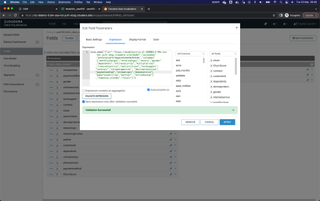

The new field should appear in the list of fields. Change the data type, selecting the type
_Integer_, which is represented by the symbol **#**.

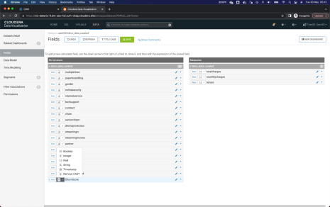

Finish the process by clicking on the green button with the legend **SAVE** in the top menu.

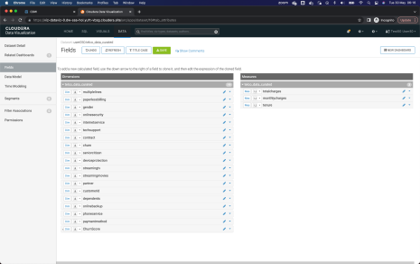

### Add Real Time Model Visual to Dashboard

Return to the dashboard, selecting the option **VISUALS** from the top menu, and clicking on
the name of the dashboard that was previously created.

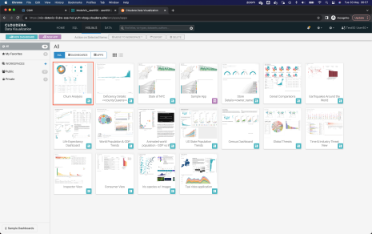

Once in the dashboard, click on the button **Edit** which is in the upper left.

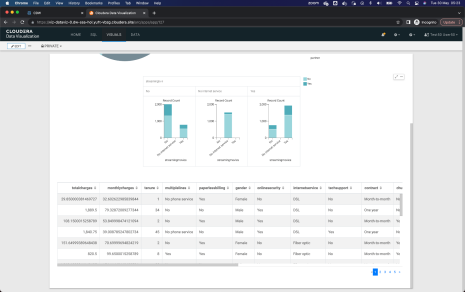

Edit the lower table by clicking on it and then on the option **Build** from the right vertical
menu. Add the new field, **ChurnScore**, at the beginning of the table, by clicking and dragging
from the option **Dimensions** available.

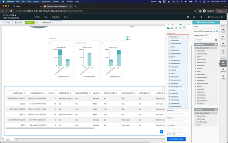

Click on the Refresh Visual button to update the data. The new column should appear
ChurnScore then at the beginning of the table, with a value of numeric type. Finish the process
by clicking the button **SAVE** from the top left menu.

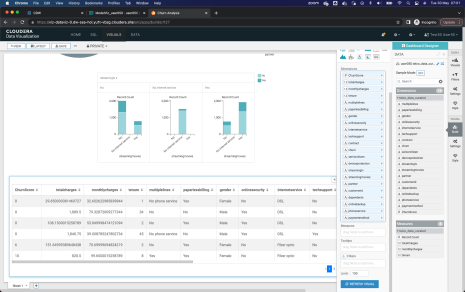

**End of Lab 5**